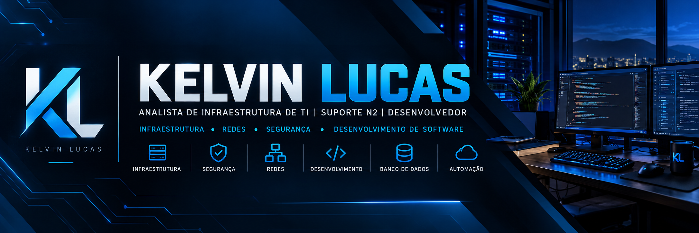

 

### 👋 Bem-vindo ao meu GitHub!

Transformando desafios tecnológicos em soluções, conectando **infraestrutura, segurança e desenvolvimento de software**.

---

## 👨‍💻 Sobre mim

Sou **Analista de Infraestrutura e Suporte N2**, com experiência em administração de ambientes corporativos, servidores, redes, segurança da informação e suporte técnico.

Também atuo no desenvolvimento de projetos pessoais, explorando tecnologias web, APIs e bancos de dados.

Busco constantemente aprimorar meus conhecimentos e aplicar a tecnologia na criação de soluções eficientes, seguras e escaláveis.

- 💼 **Atuação:** Infraestrutura corporativa e Suporte N2
- 🎓 **Formação:** Técnico em Informática e Técnico em Manutenção
- 📚 **Atualmente:** Técnico em Informática para Internet — IFSULDEMINAS
- 💻 **Desenvolvimento:** React, TypeScript, C# e ASP.NET Core
- 🐧 **Interesses:** Linux, Docker, automação e DevOps
- 📍 **Localização:** Cuiabá — MT, Brasil

---

## 🛠️ Tecnologias e Ferramentas

### 💻 Desenvolvimento Web e Back-end

### 🖥️ Infraestrutura, Redes e Segurança

### 🗄️ Banco de Dados, DevOps e Ferramentas

---

## 🚀 Projetos em Destaque

### 🌐 Portfólio Pessoal

Site desenvolvido para apresentar minha trajetória profissional, conhecimentos técnicos e projetos.

**Tecnologias:** HTML5, CSS3 e JavaScript.

**Características:**
- Layout responsivo para desktop e dispositivos móveis
- Navegação adaptada para telas menores
- Apresentação profissional e habilidades técnicas
- Publicação utilizando GitHub Pages

🔗 **[Visualizar portfólio](https://klaolp.github.io/)**

### 🏢 Portal Corporativo

Aplicação web desenvolvida para centralização e gerenciamento de comunicados internos de uma organização.

**Stack utilizada:**

**Funcionalidades do projeto:**
- Mural de comunicados
- Painel administrativo
- Visualização detalhada de publicações
- Desenvolvimento de API REST
- Integração com PostgreSQL
- Autenticação corporativa planejada

> Projeto em desenvolvimento. Código-fonte e informações internas não disponibilizados publicamente.

### 📚 Estudos e Laboratórios

Projetos e exercícios práticos relacionados a desenvolvimento web, programação, infraestrutura e administração de sistemas.

🔗 **[Explorar meus repositórios](https://github.com/klaolp?tab=repositories)**

---

## 📊 Estatísticas do GitHub

 

---

## 📫 Vamos nos conectar?

Aberto a trocar conhecimentos, colaborar em projetos e conhecer novas oportunidades profissionais.

 

**"Sempre aprendendo, evoluindo e transformando conhecimento em soluções."**

 

